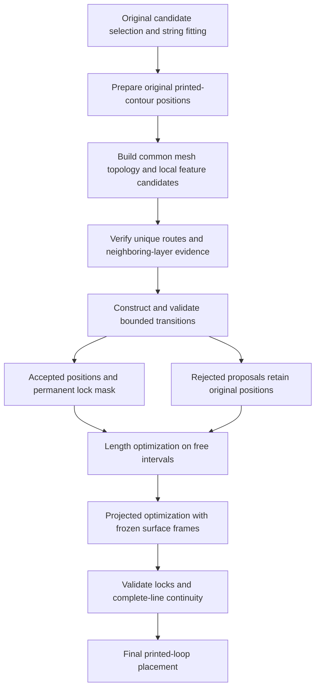

# Seam binding to mesh features — High Level Design

## Purpose and scope

Mesh feature binding moves a seam onto a verified corner of its printed layer contour and makes
that position immutable for subsequent seam optimization. It operates on existing Aligned and
Aligned Back strings after their original fitting and placement. It does not change candidate
ranking, string membership or the original fitted curve.

The pass is enabled by `ORCA_SEAM_FEATURE_ENABLED=1` and is off by default. Rear, Nearest and
Random do not use it. A selected Blocked candidate or an embedded join excludes its string.
An object containing a negative volume bypasses mesh binding because its uncut mesh does not
certify the final Boolean surface.

The target is a wall-centerline corner on the actual printed contour, rather than the raw outer
mesh edge. A geometrically verified target can become hard even below the original 55-degree
contour-angle snap. A groove without a qualifying mesh crease is outside this mechanism.

## Pipeline and ownership

`SeamPlacer::align_seam_points` prepares all eligible strings before discovery, integrates the
results and validates later optimizer outputs. `bind_seam_features` owns graph construction,
target discovery and route evidence. `accept_seam_feature_targets` owns transactional transition
construction. `seam_feature_continuous` checks the entire resulting line against the original
approximation and frozen carrier metadata. `SeamChain` optimizes remaining free contour positions.

The mesh is transformed into the same object coordinate frame as the layer contours. Indexed
adjacency and face normals are constructed for the source mesh; an AABB tree restricts geometric
inspection to corridors around all eligible original strings of one PrintObject. This requires
whole-mesh indexing but does not select every crease as a seam feature. Separate PrintObjects
do not share bindings. Mesh vertex indices define connectivity; coincident disconnected
components are never welded into a junction.

## Geometry and an immutable decision

A candidate carrier is an atomic mesh edge with exactly two incident faces, sufficient dihedral
angle and sufficient length. Degenerate or nearly horizontal carriers cannot supply an
interlayer target. Each inspected endpoint retains its complete incident star.

A target must pass all of the following checks:

1. It is an allowed vertex of the printed contour at the point's unchanged layer height.
2. The incoming and outgoing contour directions match the horizontal traces of the two faces.
   Both faces have a sufficiently large horizontal normal component, and their traces are
   sufficiently distinct.
3. Inward offsets from the two planes lie in the configured interval and agree within tolerance.
4. Paint bounds, blocked-vertex exclusion, inherited support limits and old fixed positions hold.
5. There is a unique close target consistent with all plausible interlayer routes.
6. Neighboring layers support the same carrier across a sufficient physical height.
7. The complete transition to neighboring free and fixed points is feasible.

Plane extensions beyond a carrier's height range are permitted only near a real junction with
multiple qualifying incident edges. They must still produce a verified printed-contour corner.
An isolated crease endpoint cannot extend this way. This is not an instruction to put the printed
wall centerline directly on the outer mesh vertex.

Repeated contour samples of one carrier are deduplicated. Incident carriers that describe the
same corner at their real shared node can represent one physical target. Nearby distinct
corners or coincident corners on disconnected components remain ambiguous.

Forward/backward dynamic programming scores carrier targets by squared distance from the
original position, normalized by the local width. An explicit unbound state permits endings.
All routes within the configured margin of the best route remain plausible. A target must be
the unique close alternative and the unique plausible state; then the neighboring-layer
evidence is checked. The result is a deterministic geometric decision, not a statistical
probability. A nearby locked neighbor alone does not justify locking a distant point.

An existing 55-degree contour snap or strong Precise Seam position is never moved.
With feature binding enabled, a strong Precise Seam fixes its individual point while other
members can participate. With binding disabled, the original conservative whole-string
exclusion for strong Precise Seam remains. Gray and green surfaces use the same geometric
proof; green paint adds admissible contour intervals. Proven full green coverage is normalized
as described in [seam alignment](seam-alignment.md#painted-ranges).

## Bounded transition construction

Each correction is a signed arc displacement along the point's own oriented closed contour,
with fixed Z. Its chart intersects the paint bounds, a motion radius, less than half the contour
period and the connected support interval containing the initial point.

A strictly convex quadratic penalizes displacement with diagonal weight `1 + anchor_weight`,
variation of correction slope with the configured transition scale, and variation of that slope
with the configured bending weight. These regularizers smooth the *correction field*; they do
not round certified feature geometry or add an elastic objective to the ordinary length pass.
Old locks and provisional targets are equality constraints. An active-set box solve has a
finite iteration budget.

For adjacent points, the complete-line guard requires:

`step <= max((1 + STEP_GROWTH) * reference_step, reference_step + STEP_WIDTHS * min(Wi, Wj)) + eps`.

Normally `reference_step` is their original 3D separation. If both points remain exactly on the
same certified carrier, with matching valid unit directions, `CARRIER_STEPS` permits
`reference_step = max(original_step, abs(delta_Z) / abs(carrier_direction.Z))`.
This allows a real inclined edge to require more lateral travel than a locally compressed
initial spline. Different carriers, free points and positions off the certified targets retain
the original reference.

A free transition's turn may increase by at most `TURN_ALLOWANCE`. A triple entirely certified
on geometry is exempt so a real junction can retain its bend.

Local repair intersects each free point's exact contour with spheres bounding its neighboring
steps. It compares the quadratic minimum and, when `TURN_REPAIR` is enabled, interval endpoints
and a finite grid. The selection first minimizes the largest normalized violation of affected
steps and turns, then quadratic cost. Only non-worsening repairs are retained. Every proposed
target remains fixed; the entire line is checked again.

A continuity failure removes the nearest complete contiguous provisional run and retries,
rather than retaining isolated survivors of a broken transition. Solver failure or exhaustion
accepts no new locks. Attempts are bounded by the number of points plus one. Finite repair
sampling does not prove global optimality or the absence of a feasible unsampled position.

## Support semantics and interaction with later passes

The inherited SeamPlacer indicator is:

`overhang = max(0, signed_distance_to_previous_layer_contour + 0.65 * flow_width - tan(45 degrees) * layer_height)`.

The 45-degree constant belongs to seam placement, not the profile's support-generation angle.
It is also distinct from `unsupported_dist`, whose width addition is `0.4 * flow_width`.

For a new hard target:

`support_limit = overhang(original_selected_candidate) + SUPPORT_WIDTHS * W`.

For its free transition, the allowed indicator is the maximum of this limit and the indicator at
the original final point after spline placement. A previously worse spline position need not
be repaired. Contour-segment indicators are linearly interpolated; a target must be reachable
within the connected admissible chart.

The default 0.1W allows a small worsening: at W=0.42 mm the indicator may increase by 0.042 mm.
It is not a physical clearance, a command to omit the seam, or a printability guarantee.
Refusing a new binding preserves the original seam; slicing and printing continue. Existing
hard positions remain authoritative even if their inherited indicator is worse.

Accepted geometry positions and their lock mask are permanent in both later optimizers.
Free intervals have independent cubic displacement bases. Each later result must preserve
locks and pass complete-line step/turn validation; failure keeps that optimizer's input.
The subsequent free-point support preference remains a soft penalty. The transition's hard
support allowance therefore does not guarantee that allowance for every final free point.

The projected pass's relative length allowance is measured from its accepted length-pass input.
It does not limit the total change caused by binding geometry to 1.5% of the original seam.
A zero length weight disables both numerical optimizers, but leaves enabled feature binding
active. Zero vertical weight disables its cost; geometric probing is separately controlled
by `ORCA_SEAM_CHAIN_GEOMETRIC_PROBE`.

## Controls and units

Defaults belong to `SeamFeatureOptions`; `SeamPlacer` reads process environment controls.
All table names have the prefix **`ORCA_SEAM_FEATURE_`**.
`W = max(external-wall flow width, maximum nozzle diameter)` for each point.
Corridors spanning two layers use the larger W; the additive pair-step allowance uses the smaller W.

These controls are not profile fields and are not serialized into 3MF. Launchers override only
their explicit variables; other values are inherited from their environment.

| Name | Default | Meaning |
| --- | --- | --- |
| `ENABLED` | 0 | Enable the separate geometry pass; positive values enable it. |
| `CORRIDOR_WIDTHS` | 4 | Search-corridor radius in W. |
| `MIN_ANGLE` | 15 degrees | Minimum mesh dihedral and distinguishable printed corner/face-trace separation. |
| `EDGE_WIDTHS` | 1 | Minimum atomic carrier length in W; subdivided creases are not merged. |
| `TRACE_ANGLE` | 3 degrees | Allowed contour/face-trace direction difference. |
| `OFFSET_MIN` | 0.25 | Minimum inward plane offset in W. |
| `OFFSET_MAX` | 1.5 | Maximum inward plane offset in W. |
| `OFFSET_DIFFERENCE` | 0.12 | Allowed difference of inward offsets in W, plus geometry tolerance. |
| `GEOMETRY_TOLERANCE` | 0.012 mm | Absolute addition to the offset-difference tolerance. |
| `NODE_WIDTHS` | 2 | Height reach around a real junction in W, including permitted plane extensions. |
| `NORMAL_MIN` | 0.15 | Minimum horizontal component of each unit face normal. |
| `CAPTURE_WIDTHS` | 0.75 | Maximum distance from the original point to a close target in W. |
| `EVIDENCE_LAYERS` | 3 | Minimum neighboring-layer evidence count. |
| `EVIDENCE_WINDOW` | 5 | Nominal evidence window; half on either side plus center, clipped at string ends. |
| `EVIDENCE_SPAN` | 0.5 | Minimum evidence height span in W. |
| `ROUTE_MARGIN` | 0.05 | Added cost margin admitting competing plausible routes; larger is more conservative. |
| `UNBOUND_COST` | 1 | Cost of the no-binding state in route selection. |
| `TRANSITION_SPAN` | 4 mm | Correction-slope regularization scale. |
| `TRANSITION_BENDING` | 0.05 | Weight for correction-slope variation. |
| `BRIDGE_WIDTHS` | 0.75 | Maximum correction arc length in W. |
| `ARC_FRACTION` | 0.49 | Additional motion cap as a fraction of the complete contour period. |
| `STEP_GROWTH` | 0.25 | Relative additional neighboring-step allowance. |
| `STEP_WIDTHS` | 0.15 | Absolute additional neighboring-step allowance in the smaller W. |
| `TURN_ALLOWANCE` | 20 degrees | Added free-transition turn allowance. |
| `SUPPORT_WIDTHS` | 0.1 | Allowed worsening of the inherited overhang indicator in W. |
| `CARRIER_STEPS` | 1 | Enable inclination-based step references on exact same-carrier targets. |
| `TURN_REPAIR` | 1 | Enable turn-aware finite local repair; final turn validation always applies. |
| `REPAIR_SAMPLES` | 32 | Interval divisions, clamped to 1–256; 32 gives 33 grid samples. |
| `MAX_ITERATIONS` | 128 | Active-set transition-solve budget. |
| `REPAIR_SWEEPS` | 8 | Local-repair sweep budget; zero disables repair. |
| `MAX_POINTS` | 1500 | Maximum string size for feature binding. |
| `MAX_QUERIES` | 1000000 | Spatial inspection budget for the common object graph. |
| `MAX_CANDIDATES` | 32 | Maximum target alternatives and local-repair interval count. |
| `SOLVE_TOLERANCE` | 1e-7 | Active-set numerical tolerance and evidence-span comparison tolerance. |

Absent variables retain defaults. Present malformed, negative or nonfinite values become zero.
Zero can disable a switch or invalidate the option set; it does not restore the default.
Integer budgets truncate fractional values and are capped at 1000000. Repair sampling has its
own 1–256 clamp. An even evidence window yields the next larger odd actual window.

Validation requires positive geometric scales, nonnegative allowances, `MIN_ANGLE < 90`,
`TRACE_ANGLE < 90`, `NORMAL_MIN < 1`, `OFFSET_MIN < OFFSET_MAX`,
`ARC_FRACTION < 0.5`, `TURN_ALLOWANCE <= 180`, at least two evidence layers,
a window no smaller than the evidence count and no greater than 101, and valid solver budgets.
Invalid controls decline binding; there is no dedicated GUI warning.

The fixed geometric epsilon is 1e-5 mm; turn comparisons use the same numerical epsilon in
degrees. Smaller epsilon fractions protect contour stepping and segment/sphere intersections.
These roundoff guards are separate from physical capture and movement tolerances.

## Failure visibility and limitations

`SeamFeatureResult` carries accepted positions, the permanent lock mask, the geometry mask
and per-point `SeamFeatureBinding` metadata. Metadata includes the carrier identity, target,
contour arc and unit carrier direction. Carrier identity is scoped to one graph construction.

`ORCA_SEAM_CHAIN_DUMP` also produces `-features.csv` when binding is enabled. It records the
original position, transition position, final optimized position, old/new fixed flags, acceptance
and carrier direction. States are None (0), Ambiguous (1), InsufficientEvidence (2), Proposed (3),
Locked (4), TransitionRejected (5) and Budget (6). A Locked state can describe a pre-existing
fixed point; consult the original fixed flag to distinguish a newly created lock.

Spatial-budget exhaustion discards the partial graph. Too many target alternatives decline
that string instead of silently retaining a convenient subset. Too many repair intervals skip
that local repair attempt; final continuity validation still decides acceptance. A visible crease
can remain unbound because it is short, ambiguous, weakly evidenced, beyond the motion chart,
unsupported or impossible to reach through an accepted transition.

The mechanism does not merge collinear atomic subdivisions, certify every complex junction,
infer grooves, or search a global optimum. A free point may improve without reaching an edge.
These conservative outcomes preserve the prior line rather than fabricate a geometric proof.

## Code and validation contracts

- [SeamFeature.hpp](../../src/libslic3r/GCode/SeamFeature.hpp): controls, binding states and result contracts.
- [SeamFeature.cpp](../../src/libslic3r/GCode/SeamFeature.cpp): graph, proof, routing, transition solve and validation.
- [SeamPlacer.cpp](../../src/libslic3r/GCode/SeamPlacer.cpp): integration, configuration and final metadata.
- [SeamChain.cpp](../../src/libslic3r/GCode/SeamChain.cpp): free-interval displacement optimization.
- [test_seam_feature.cpp](../../tests/libslic3r/test_seam_feature.cpp): geometry proof, ambiguity,
  inherited locks, transition failure, exact-carrier step references and turn-repair regressions.
- [test_seam_chain.cpp](../../tests/libslic3r/test_seam_chain.cpp): optimization and contour constraints.

The essential contracts are unchanged original candidate ranking, exact preservation of existing
and accepted locks, fixed layer heights, admissible printed-contour positions and paint ranges,
and transactional rejection of an invalid complete transition. Final G-code wall starts remain
part of model validation because spatial displacement fields alone do not prove printed placement.
